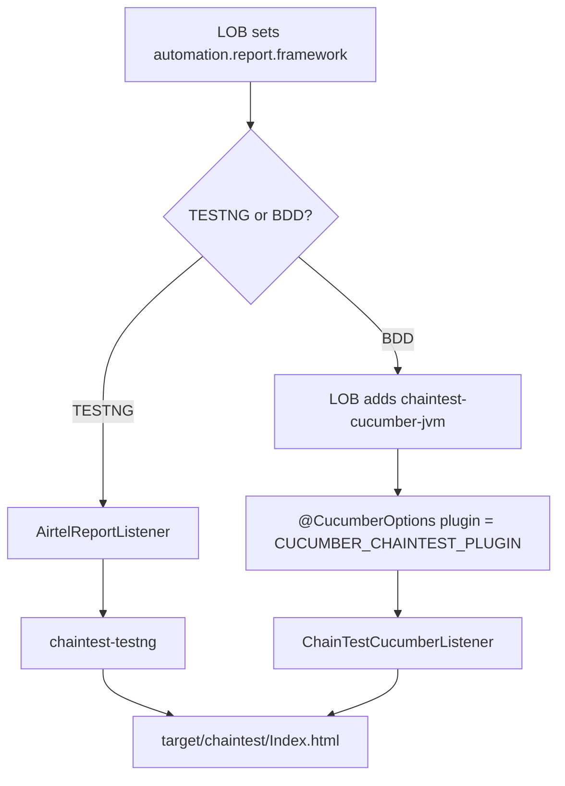

# Backend Automation Framework

Multi-module Java **21** API automation library for LOB projects (TestNG or BDD/Cucumber).

```
GroupId:  com.airtel.api-automation
Version:  1.0.1
Artifact: automation-bundle | automation-core | …
```

## Modules

| Module | Contents |
|--------|----------|
| `automation-exceptions` | `GenericException`, `ErrorCode`, `@CatchException`, `Constants`, `AirtelConfigService` |
| `automation-report` | HTML `ReportHelper`, ChainTest, `ReportSelector` (TESTNG/BDD), FileHelper, Influx, SentinelLogger |
| `automation-data` | Excel / DB / Mongo / Aerospike / JSON / Data helpers |
| `automation-validator` | JSON compare & schema validators |
| `automation-core` | `ApiHelper`, `BaseManager`, WireMock, DTOs |
| `automation-bundle` | Aggregator POM — single LOB dependency |

Logging uses **SLF4J** (`LoggerFactory` / `@Slf4j`). LOBs provide the binding (Logback, Log4j2, etc.).

Source lives under each module (`automation-*/src/main/...`). There is **no** root `src/main`. IDE folders (`.settings`, `.classpath`, `.project`, `.vscode`) are gitignored.

## Add to an LOB (e.g. clm-be-automation)

**All modules:**

```xml
<dependency>
  <groupId>com.airtel.api-automation</groupId>
  <artifactId>automation-bundle</artifactId>
  <version>1.0.1</version>
  <type>pom</type>
</dependency>
```

**Or core only** (pulls data / validator / report / exceptions transitively):

```xml
<dependency>
  <groupId>com.airtel.api-automation</groupId>
  <artifactId>automation-core</artifactId>
  <version>1.0.1</version>
</dependency>
```

Until published to Nexus, install locally:

```bash
mvn clean install -DskipTests
```

### Migrate from 1.4.x

Replace:

```xml
<artifactId>api-automation-framework</artifactId>
<version>1.4.x</version>
```

with `automation-bundle` or `automation-core` at `1.0.1`. Packages remain under `com.airtel.helper.*`.

## Reporting walkthrough (ChainTest only)



### 1. Config (LOB)
```properties
# src/test/resources/automation-report.properties
automation.report.framework=TESTNG
# or BDD
```

### 2. TestNG LOB
```java
@Listeners(AirtelReportListener.class)
public class BaseTest { }
```
Dep `chaintest-testng` comes from `automation-report`.

### 3. BDD LOB (extra dep required)
```xml
<dependency>
  <groupId>com.aventstack</groupId>
  <artifactId>chaintest-cucumber-jvm</artifactId>
  <version>1.0.12</version>
</dependency>
```
```java
@CucumberOptions(plugin = { ReportFrameworkConfig.CUCUMBER_CHAINTEST_PLUGIN })
public class RunCukes extends AbstractTestNGCucumberTests { }
```

### 4. Output
`target/chaintest/Index.html`

### What stays in `automation-report`
| Keep | Role |
|------|------|
| `ReportFrameworkConfig` / `FrameworkType` / `ReportSelector` | Pick TESTNG vs BDD ChainTest |
| `AirtelReportListener` | ChainTest TestNG + optional `@CatchException` |
| `CatchExceptionListener` | Log framework exceptions on `@Test` failure |
| `ReportHelper` (slim) | Step logging used by ApiHelper / DB / Mongo (not suite HTML) |
| `FileHelper` / `ComparatorReportGenerator` / `ReportConstants` | Request-response files & JSON diff links |
| `SentinelLogger` | Sentinel debug items |
| `chaintest.properties` | Default ChainTest generator config |

### Removed
- Suite HTML lifecycle (`@BeforeSuite` / charts / suite summary) from `ReportHelper`
- `InfluxDbHelper` + `influxdb-java` (was only for old suite stats)

### Exception reporting (TestNG only)
```java
@Listeners(AirtelReportListener.class)
@CatchException
public class BaseTest { }
```
For Cucumber steps, use `@After` — `@CatchException` does not apply to step methods.

## Suggested LOB layout

```
src/main/java/.../constants
src/main/java/.../controller
src/main/java/.../helper
src/main/java/.../dto
src/main/resources/   # automation-report.properties, chaintest.properties
src/test/java/...
```

- **TestNG:** `@Listeners(AirtelReportListener.class)`
- **BDD:** ChainTest Cucumber plugin + `chaintest-cucumber-jvm`

## Main capabilities

| Area | Classes |
|------|---------|
| HTTP / RestAssured | `ApiHelper`, `BaseManager` |
| Mocks | `WiremockHelper` |
| Validations | `ApiResponseValidator`, `GenericComparator` |
| Data | `DbHelper`, `MongoHelper`, `AerospikeHelper`, `ExcelHelper`, `TestDataHelper` |
| Config | `AirtelConfigService`, `Constants` (in `automation-exceptions`) |
| Logging | SLF4J (`@Slf4j` / `LoggerFactory`) — binding supplied by LOB |
| Reports | `ReportHelper`, `AirtelReportListener`, ChainTest |

## Sentinel libraries

| Component | Version |
|-----------|---------|
| Subscriber TestNG | 1.1.8 |
| Transformer optimus-java | 1.1.7 |
| Sentinel models | 2.0.7 |
| Sentinel Log4j Appender | 1.0.7 |
